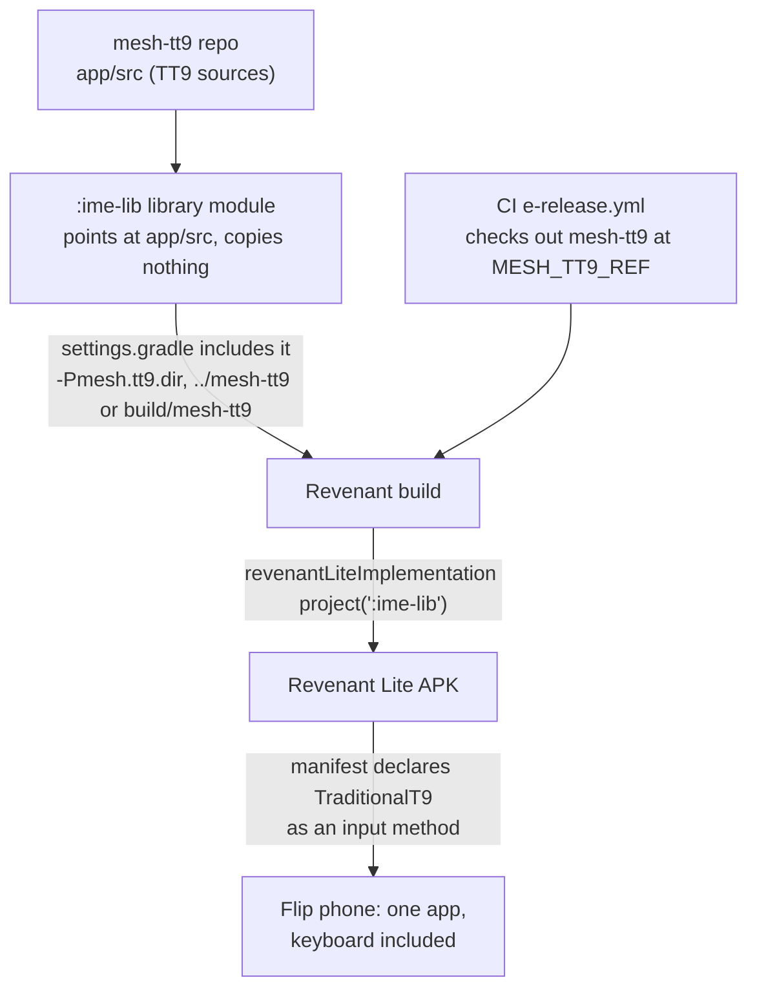

# Traditional T9 

TT9 is a Nokia-style T9 keyboard for Android. It provides predictive text input in [40+ languages](app/languages/definitions), configurable hotkeys, clipboard, undo/redo, and extensive customization. It works on touchscreens, physical keypads, and TV remote controls. And best of all, it [doesn't spy](docs/privacy.md) on you!

This is a modernized version of the [original project](https://github.com/Clam-/TraditionalT9) by Clam-.

## Screenshots
<table>
    <tr>
        <td>  </td>
        <td rowspan="2">  </td>
        <td rowspan="2">  </td>
        <td rowspan="2">  </td>
        <td rowspan="2">  </td>
    </tr>
    <tr>
        <td>  </td>
    </tr>
</table>

## Install

[](https://play.google.com/store/apps/details?id=io.github.sspanak.tt9)&nbsp;&nbsp;&nbsp;&nbsp;
[](https://f-droid.org/app/io.github.sspanak.tt9)&nbsp;&nbsp;&nbsp;&nbsp;
[](https://io-github-sspanak-tt9.en.uptodown.com/android)&nbsp;&nbsp;&nbsp;&nbsp;
[](https://github.com/sspanak/tt9/releases/latest)


_If your phone does not have Google Play and does not allow installing custom APKs, please consult the [Installation Guide](docs/installation.md)._

## System Requirements
- Full version: Android 7.0 or higher
- Lite version: Android 8.0 or higher
- Storage space depends on the Android version. The lite version requires at least 6-8 Mb and the full version requires at least 220 Mb.
- Extra storage space is necessary for language dictionaries in Predictive Mode.
    - Languages with character predictions only (Korean): ~1 Mb per language
    - Tiny languages (< 100k words; Kiswahili, Indonesian, Vietnamese): 5-6 Mb per language.
    - Small languages (100k-400k words; e.g. English, Norwegian, Swedish, Finnish, French): 15-30 Mb per language.
    - Medium languages (400k-800k words; e.g. Chinese, Danish, Greek, Italian, Portuguese): 40-75 Mb per language
    - Large languages (800k-1.6M words; e.g. Arabic, Bulgarian, Hebrew, Japanese, Romanian, Spanish): 100-170 Mb per language

_Storage usage for the dictionaries depends on the word root count and the average word length in each language. Some languages will require more space, even if they have fewer words than others._

### Compatibility

#### 1. Check your Android version
- Android 8.0+ → Install latest version (Play Store, F-Droid, or GitHub)
- Android 7.x → Install latest full version from GitHub (manual)
- Android 5–6 → Install full v60.0
- Android 4.4 → Install full v44.0
- Android ≤4.3 → Install legacy Traditional T9 Keypad IME from 2016

_On devices without Internet access, always use the full version from GitHub._

#### 2. If your device is unusual
On heavily customized phones (e.g. TCL Flip 2, Kyocera phones, especially if running Android 10+), you may experience issues:
  - empty gaps/misaligned items on the screen
  - unexpected text/numbers appearing when you try to type
  - incomplete integration with the native apps (e.g. "send" button not working, missing hotkey functions, etc.)

#### 3. Want guaranteed compatibility?
Use one of the tested phones:
- Motorola g05 (Android 15)
- CAT S22 Flip (Android 11)
- Unihertz Atom L (Android 11)
- Qin F21 Pro+ (Android 11)
- Energizer H620SEU (Android 10)
- Sonim XP3800 (Android 8.1)

## How to Use Traditional T9?
Before using Traditional T9 for the first time you need to configure it and load a dictionary. After that, you can start typing right away in one of the three modes: Predictive, ABC, or Numeric (123). And even if you have mastered the keypad back in the day, you will still find the Predictive mode now offers more powerful and smart new ways of typing with even fewer key presses.

So make sure to read the initial setup and the hotkey tips in the [user manual](docs/help/help.en.md). Also, don't miss the convenient [compatibility options](docs/help/help.en.md#troubleshooting) aimed to improve the experience in some applications.

_The user manual is also available in: [Brazilian Portuguese](docs/help/help.pt.md), [German](docs/help/help.de.md), [French](docs/help/help.fr.md), [Italian](docs/help/help.it.md), [Russian](docs/help/help.ru.md), [Spanish](docs/help/help.es.md), [Turkish](docs/help/help.tr.md), [Ukrainian](docs/help/help.uk.md)._

## mesh-tt9: the keyboard as a library

This fork (mesh-tt9) adds an `:ime-lib` Android library module, so another app can ship the TT9 keyboard **inside its own APK** instead of asking users to install a second app. The library compiles the same sources as the TT9 app (`ime-lib/build.gradle` points its source sets at `app/src`; nothing is copied), so upstream fixes merge in once and reach every host.

### How Revenant uses it


Revenant Lite, the flip-phone build of Revenant, bundles the keyboard as a system input method (operator ruling 2026-10-27):
- **Finding the module.** Revenant's `settings.gradle` looks for `mesh-tt9` at `-Pmesh.tt9.dir=<path>`, then `../mesh-tt9` beside the Revenant checkout, then `build/mesh-tt9`, and includes `:ime-lib` from the first one that has `ime-lib/build.gradle`.
- **Depending on it.** `build.gradle` adds `revenantLiteImplementation project(':ime-lib')`. Building the Lite flavor with no mesh-tt9 checkout fails loudly and says where to clone it.
- **Declaring the service.** `src/revenantLite/AndroidManifest.xml` declares `io.github.sspanak.tt9.ime.TraditionalT9` as an input method (`BIND_INPUT_METHOD`, `android.view.im` → `@xml/method`) and `PreferencesActivity` for its settings. The library leaves label, icon and theme to the host, so no `tools:replace` is needed.
- **CI.** Revenant's `e-release.yml` checks this repo out to `build/mesh-tt9` at `vars.MESH_TT9_REF` (a second checkout pinned by ref, not a vendored copy) with full history, because TT9 derives its version code from git.

### Using it in another project
1. **Put this repo beside yours** (or anywhere, and pass `-Pmesh.tt9.dir=/path/to/mesh-tt9`). Keep full git history: the version code is derived from it.
2. **Include the module** in your `settings.gradle`:
   ```groovy
   include ':ime-lib'
   project(':ime-lib').projectDir = new File(rootDir, '../mesh-tt9/ime-lib')
   ```
3. **Depend on it** from your app (or one flavor): `implementation project(':ime-lib')`. Your `minSdk` must be at least 24.
4. **Declare the input method and its settings screen** in your app's manifest:
   ```xml
   <service android:name="io.github.sspanak.tt9.ime.TraditionalT9"
            android:label="@string/app_name"
            android:permission="android.permission.BIND_INPUT_METHOD"
            android:exported="true">
     <intent-filter><action android:name="android.view.InputMethod" /></intent-filter>
     <meta-data android:name="android.view.im" android:resource="@xml/method" />
   </service>
   <activity android:name="io.github.sspanak.tt9.preferences.PreferencesActivity" android:exported="true" />
   ```
5. **Pick bundled dictionaries** with `-Ptt9.bundledDictionaries=en,de` (default: none; every other language downloads on demand from the keyboard's settings).
6. **Build options.** Where SDK 37 isn't installed, build with `-Ptt9CompileSdk=35 -Ptt9TargetSdk=35`. The module uses plain, long-stable Gradle DSL so it works with your Android Gradle Plugin too (Revenant uses 8.9.3).
7. **Enable it on the phone.** Settings → System → Languages & input → On-screen keyboard, turn on the keyboard, then choose it as the input method. On many flip phones it is easiest over adb:
   ```
   adb shell ime list -s
   adb shell ime enable <your.app.id>/io.github.sspanak.tt9.ime.TraditionalT9
   adb shell ime set <your.app.id>/io.github.sspanak.tt9.ime.TraditionalT9
   ```

Your app owns the application id, version, signing and launcher; the library owns only the keyboard. TT9's Apache-2.0 notice (`LICENSE.txt`) travels with the library sources and must ship with your app. `tests/test_ime_lib.py` checks the module stays includable by a host.

## Contributing
As with many other open-source projects, this one is also maintained by its author in his free time. Any help in making Traditional T9 better will be highly appreciated. Here is how:
- Add [a new language](CONTRIBUTING.md#adding-a-new-language), [new UI translations](CONTRIBUTING.md#translating-the-ui) or simply fix a spelling mistake. The process is very simple and even with minimum technical knowledge, your skills as a native speaker will be of great use. Or, if you are not tech-savvy, just [open a new issue](https://github.com/sspanak/tt9/issues) and put the correct translations or words there. Correcting misspelled words or adding new ones is the best you can do to help. Processing millions of words in multiple languages is a very difficult task for a single person.
- Share your list of added words. Use the Export function in Settings → Languages → Added Words and upload the generated CSV file in a [new issue](https://github.com/sspanak/tt9/issues). You are also welcome to [open a PR](https://github.com/sspanak/tt9/pulls) if you have good technical knowledge and can split them by language.
- [Report bugs](https://github.com/sspanak/tt9/issues) or other unusual behavior on different phones. It is only possible to verify correct operation and compatibility on a handful of phones, but Android behavior and appearance vary a lot across the millions of devices available out there.
- Experienced developers, who are willing to get your hands dirty with the code, see the [Contribution Guide](CONTRIBUTING.md).

Your PRs are welcome!

## Support
The best way to support the project is to give it five stars on Google Play. While it may sound trivial, good reviews really motivate me to keep working on it. They also encourage the Play Store to promote TT9 to more people and ultimately help spread the word.

You can also give the project a star on GitHub. Higher-ranked projects can access development tools for free and apply for funding more easily.

And if you truly enjoy using TT9, buy me a beer on [Ko-Fi](https://ko-fi.com/sspanak) or buy Premium on Google Play.

## Philosophy
- No spying, tracking, telemetry, reports, or data collection of any sort.
- No ads or unnecessary bells and whistles. It only does its job, typing.
- No unnecessary network connections. The Full version operates entirely offline, and the Lite version connects only to download dictionaries from GitHub. Voice Input may require Internet access, depending on the available voice services.
- Open-source, permitting you to verify all the above yourself.
- Created with help from the entire community.
- Things it will (probably) never have: QWERTY layout, swipe-typing, GIFs, and stickers.
- Not intended as a clone of TouchPal, Sony Ericsson, KaiOS, Samsung, etc. While it captures the feel of the classics, TT9 offers its own experience and won’t replicate any device or app exactly.

_Note: the Google Play version is almost identical to the lite version, except that it includes extra "premium" features that are closed-source. Nevertheless, none of the extra components compromises the principles outlined above._

## License
- The source code, the logo image, and the icons are licensed under the conditions described in [LICENSE.txt](LICENSE.txt).
- The dictionaries are licensed under the licenses provided in the [respective readme files](docs/dictionaries), where applicable. Detailed information about the dictionaries is also available there.
